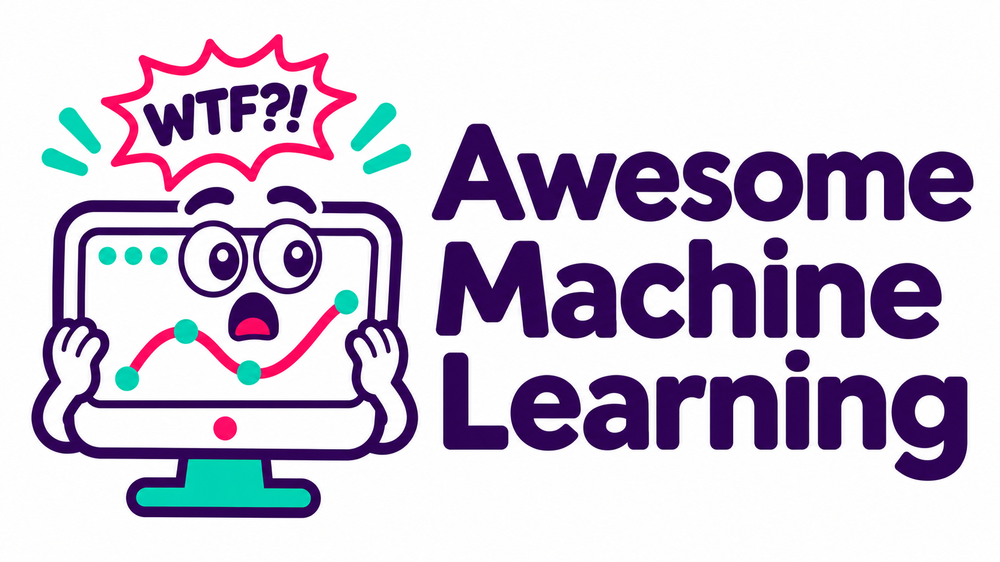

  

# Awesome Machine Learning

156 öffentliche Projekte in 24 Kategorien. Stand: 13. November 2026. Der [Katalog](KATALOG.md) führt vom Einsatzzweck zum Originalprojekt und nennt die Lizenz, soweit GitHub sie ausweist.

**Wo anfangen?** Für Tabellen genügt oft eine einfache Baseline. Für Zeitreihen entscheidet der Prognosehorizont über den Vergleich. Bei lokaler Inferenz lohnt sich eine eigene Messung von Modellgüte und Laufzeit.

[Vergleichsstudien und Messprotokolle](VERGLEICHE.md) · [Seltene Treffer und Fehlalarme](VERGLEICHE.md#seltene-treffer) · [Kalibrierung](VERGLEICHE.md#kalibrierung) · [Datenverschiebung](VERGLEICHE.md#datenverschiebung) · [Projektindex](#projektindex)

## Werkzeugauswahl

| Vorhaben | Einstieg | Erster Vergleich |
|---|---|---|
| Tabellen klassifizieren | [scikit-learn](https://github.com/scikit-learn/scikit-learn), [CatBoost](https://github.com/catboost/catboost) | Ein Dummy-Modell, eine lineare Baseline und Boosting auf denselben Splits bewerten. |
| Viele Modellfamilien ausprobieren | [AutoGluon](https://github.com/autogluon/autogluon), [Optuna](https://github.com/optuna/optuna) | Mit AutoGluon Tabellenmodelle unter einem Zeitbudget vergleichen. Mit Optuna den Suchraum selbst festlegen. |
| Den Absatz der nächsten Woche schätzen | [StatsForecast](https://github.com/Nixtla/statsforecast) | Eine saisonale Baseline über mehrere historische Prognosestichtage prüfen. |
| Trainingsdaten wiederholt aufbereiten | [Polars](https://github.com/pola-rs/polars), [DuckDB](https://github.com/duckdb/duckdb) | Dieselbe Parquet-Datei mit DataFrame-Ausdrücken oder SQL filtern und aggregieren. |
| Erklärungen für ein Tabellenmodell untersuchen | [SHAP](https://github.com/shap/shap) | Für eine auffällige Vorhersage die Beiträge einzelner Merkmale untersuchen. |
| Neuronale Netze lokal trainieren | [PyTorch](https://github.com/pytorch/pytorch), [MLX](https://github.com/ml-explore/mlx) | Auf Apple Silicon ein kleines Modell mit derselben Batchgröße messen. |
| Laufzeitänderungen erkennen | [Hyperfine](https://github.com/sharkdp/hyperfine), [asv](https://github.com/airspeed-velocity/asv) | Mit Hyperfine zwei Befehle vergleichen. Mit asv Python-Benchmarks über mehrere Revisionen verfolgen. |

## Einen fairen Vergleich aufsetzen

Bei einer Nachfrageprognose zuerst die letzten Wochen als Testzeitraum reservieren. Auf den früheren Wochen mehrere Stichtage wählen und jedes Modell denselben Horizont vorhersagen lassen. Vorverarbeitung und Modellparameter ausschließlich auf den jeweiligen Trainingsdaten fitten. [scikit-learn-Leitfaden zu Datenlecks](https://scikit-learn.org/stable/common_pitfalls.html)

An jedem Stichtag den mittleren absoluten Fehler für Baseline und Kandidat erfassen. Den zurückgehaltenen Testzeitraum erst für das ausgewählte Modell öffnen. Für einen Laufzeitvergleich Eingabe, Hardware und Warm-up dokumentieren. Der JSON-Export von Hyperfine enthält die Einzelmessungen. [Hyperfine-Dokumentation](https://github.com/sharkdp/hyperfine#exporting-results)

## Projektindex

[Agenten](KATALOG.md#agenten) · [Apple Silicon](KATALOG.md#apple-silicon) · [AutoML](KATALOG.md#automl) · [Bildverarbeitung](KATALOG.md#bildverarbeitung) · [Datenaufbereitung](KATALOG.md#datenaufbereitung) · [Diffusion](KATALOG.md#diffusion) · [Embeddings](KATALOG.md#embeddings) · [Erklärbarkeit und Datenqualität](KATALOG.md#erklärbarkeit-und-datenqualität) · [Evaluation](KATALOG.md#evaluation) · [Fine-Tuning](KATALOG.md#fine-tuning) · [Inferenz und Serving](KATALOG.md#inferenz-und-serving) · [Klassisches ML](KATALOG.md#klassisches-ml) · [Laufzeitmessung](KATALOG.md#laufzeitmessung) · [Lernen aus Feedback](KATALOG.md#lernen-aus-feedback) · [MLOps](KATALOG.md#mlops) · [Quantisierung](KATALOG.md#quantisierung) · [Retrieval-Augmented Generation](KATALOG.md#retrieval-augmented-generation) · [Rust](KATALOG.md#rust) · [Sprache und Audio](KATALOG.md#sprache-und-audio) · [Tabellendaten](KATALOG.md#tabellendaten) · [Training und Tensorbibliotheken](KATALOG.md#training-und-tensorbibliotheken) · [Vektordatenbanken](KATALOG.md#vektordatenbanken) · [Verteiltes Training](KATALOG.md#verteiltes-training) · [Zeitreihen](KATALOG.md#zeitreihen)

Die Kurzbeschreibungen und Lizenzangaben unten stammen aus den GitHub-Projektmetadaten. Für Modelle und Datensätze können eigene Bedingungen gelten.

### Agenten

| Projekt | Beschreibung des Projekts | Lizenz |
|---|---|---|
| [BerriAI/litellm](https://github.com/BerriAI/litellm) | The fastest, litest AI Gateway. Rust core with Python SDK. Call 100+ LLM APIs in OpenAI (or native) format with cost tracking, guardrails, load balancing, and logging &#91;Bedrock, Azure, OpenAI, Anthropic, OpenAI, VertexAI, vLLM, Nvidia NIM&#93; | siehe Repository |
| [browser-use/browser-use](https://github.com/browser-use/browser-use) | Open-source Python library for AI browser agents, plus Browser Use Cloud: stealth browsers and a hosted agent API. | MIT |
| [crewAIInc/crewAI](https://github.com/crewAIInc/crewAI) | Framework for orchestrating role-playing, autonomous AI agents. By fostering collaborative intelligence, CrewAI empowers agents to work together seamlessly, tackling complex tasks. | MIT |
| [FoundationAgents/MetaGPT](https://github.com/FoundationAgents/MetaGPT) | 🌟 The Multi-Agent Framework: First AI Software Company, Towards Natural Language Programming | MIT |
| [langchain-ai/langchain](https://github.com/langchain-ai/langchain) | The agent engineering platform. | MIT |
| [langchain-ai/langgraph](https://github.com/langchain-ai/langgraph) | Build resilient agents. | MIT |
| [microsoft/autogen](https://github.com/microsoft/autogen) | A programming framework for agentic AI | CC-BY-4.0 |
| [microsoft/semantic-kernel](https://github.com/microsoft/semantic-kernel) | Integrate cutting-edge LLM technology quickly and easily into your apps | MIT |
| [openai/openai-agents-python](https://github.com/openai/openai-agents-python) | A lightweight, powerful framework for multi-agent workflows | MIT |
| [pydantic/pydantic-ai](https://github.com/pydantic/pydantic-ai) | How Python does AI. Agents, realtime voice, image generation, embeddings. Every model, every interface, typed end to end. | MIT |
| [Significant-Gravitas/AutoGPT](https://github.com/Significant-Gravitas/AutoGPT) | AutoGPT is the vision of accessible AI for everyone, to use and to build on. Our mission is to provide the tools, so that you can focus on what matters. | siehe Repository |
| [stanfordnlp/dspy](https://github.com/stanfordnlp/dspy) | DSPy: The framework for programming—not prompting—language models | MIT |

### Apple Silicon

| Projekt | Beschreibung des Projekts | Lizenz |
|---|---|---|
| [huggingface/swift-transformers](https://github.com/huggingface/swift-transformers) | Swift Package to implement a transformers-like API in Swift | Apache-2.0 |
| [ml-explore/mlx](https://github.com/ml-explore/mlx) | MLX: An array framework for Apple silicon | MIT |
| [ml-explore/mlx-swift](https://github.com/ml-explore/mlx-swift) | Swift API for MLX | MIT |

### AutoML

| Projekt | Beschreibung des Projekts | Lizenz |
|---|---|---|
| [automl/auto-sklearn](https://github.com/automl/auto-sklearn) | Automated Machine Learning with scikit-learn | BSD-3-Clause |
| [automl/SMAC3](https://github.com/automl/SMAC3) | SMAC3: A Versatile Bayesian Optimization Package for Hyperparameter Optimization | siehe Repository |
| [facebookresearch/nevergrad](https://github.com/facebookresearch/nevergrad) | A Python toolbox for performing gradient-free optimization | MIT |
| [hyperopt/hyperopt](https://github.com/hyperopt/hyperopt) | Distributed Asynchronous Hyperparameter Optimization in Python | siehe Repository |
| [keras-team/autokeras](https://github.com/keras-team/autokeras) | AutoML library for deep learning | Apache-2.0 |
| [meta/Ax](https://github.com/meta/Ax) | Adaptive Experimentation Platform | MIT |
| [microsoft/FLAML](https://github.com/microsoft/FLAML) | A fast library for AutoML and tuning. Join our Discord: https://discord.gg/Cppx2vSPVP. | MIT |
| [nnaisense/evotorch](https://github.com/nnaisense/evotorch) | Advanced evolutionary computation library built directly on top of PyTorch, created at NNAISENSE. | Apache-2.0 |
| [optuna/optuna](https://github.com/optuna/optuna) | A hyperparameter optimization framework | MIT |
| [ray-project/ray](https://github.com/ray-project/ray) | Ray is an AI compute engine. Ray consists of a core distributed runtime and a set of AI Libraries for accelerating ML workloads. | Apache-2.0 |
| [syne-tune/syne-tune](https://github.com/syne-tune/syne-tune) | Large scale and asynchronous Hyperparameter and Architecture Optimization at your fingertips. | Apache-2.0 |
| [the-dual-space/pymoo](https://github.com/the-dual-space/pymoo) | NSGA2, NSGA3, R-NSGA3, MOEAD, Genetic Algorithms (GA), Differential Evolution (DE), CMAES, PSO | Apache-2.0 |

### Bildverarbeitung

| Projekt | Beschreibung des Projekts | Lizenz |
|---|---|---|
| [facebookresearch/segment-anything](https://github.com/facebookresearch/segment-anything) | The repository provides code for running inference with the SegmentAnything Model (SAM), links for downloading the trained model checkpoints, and example notebooks that show how to use the model. | Apache-2.0 |
| [open-mmlab/mmdetection](https://github.com/open-mmlab/mmdetection) | OpenMMLab Detection Toolbox and Benchmark | Apache-2.0 |
| [roboflow/supervision](https://github.com/roboflow/supervision) | We write your reusable computer vision tools. 💜 | MIT |
| [ultralytics/ultralytics](https://github.com/ultralytics/ultralytics) | Ultralytics YOLO27, YOLO26, YOLO11, YOLOv8 — object detection, instance segmentation, semantic segmentation, image classification, pose estimation, object tracking | AGPL-3.0 |

### Datenaufbereitung

| Projekt | Beschreibung des Projekts | Lizenz |
|---|---|---|
| [apache/arrow](https://github.com/apache/arrow) | Apache Arrow is the universal columnar format and multi-language toolbox for fast data interchange and in-memory analytics | Apache-2.0 |
| [huggingface/datasets](https://github.com/huggingface/datasets) | 🤗 The largest hub of ready-to-use datasets for AI models with fast, easy-to-use and efficient data manipulation tools | Apache-2.0 |

### Diffusion

| Projekt | Beschreibung des Projekts | Lizenz |
|---|---|---|
| [AUTOMATIC1111/stable-diffusion-webui](https://github.com/AUTOMATIC1111/stable-diffusion-webui) | Stable Diffusion web UI | AGPL-3.0 |
| [black-forest-labs/flux](https://github.com/black-forest-labs/flux) | Official inference repo for FLUX.1 models | Apache-2.0 |
| [Comfy-Org/ComfyUI](https://github.com/Comfy-Org/ComfyUI) | The most powerful and modular diffusion model GUI, api and backend with a graph/nodes interface. The fastest local inference engine in the world. | GPL-3.0 |
| [huggingface/diffusers](https://github.com/huggingface/diffusers) | 🤗 Diffusers: State-of-the-art diffusion models for image, video, and audio generation in PyTorch. | Apache-2.0 |
| [lllyasviel/Fooocus](https://github.com/lllyasviel/Fooocus) | Focus on prompting and generating | GPL-3.0 |

### Embeddings

| Projekt | Beschreibung des Projekts | Lizenz |
|---|---|---|
| [FlagOpen/FlagEmbedding](https://github.com/FlagOpen/FlagEmbedding) | Retrieval and Retrieval-augmented LLMs | MIT |
| [huggingface/sentence-transformers](https://github.com/huggingface/sentence-transformers) | State-of-the-Art Embeddings, Retrieval, and Reranking | Apache-2.0 |
| [huggingface/text-embeddings-inference](https://github.com/huggingface/text-embeddings-inference) | A blazing fast inference solution for text embeddings models | Apache-2.0 |
| [MinishLab/model2vec](https://github.com/MinishLab/model2vec) | Fast State-of-the-Art Static Embeddings | MIT |
| [qdrant/fastembed](https://github.com/qdrant/fastembed) | Fast, Accurate, Lightweight Python library to make State of the Art Embedding | Apache-2.0 |

### Erklärbarkeit und Datenqualität

| Projekt | Beschreibung des Projekts | Lizenz |
|---|---|---|
| [unionai-oss/pandera](https://github.com/unionai-oss/pandera) | A light-weight, flexible, and expressive statistical data testing library | MIT |

### Evaluation

| Projekt | Beschreibung des Projekts | Lizenz |
|---|---|---|
| [confident-ai/deepeval](https://github.com/confident-ai/deepeval) | The LLM Evaluation Framework | Apache-2.0 |
| [EleutherAI/lm-evaluation-harness](https://github.com/EleutherAI/lm-evaluation-harness) | A framework for few-shot evaluation of language models. | MIT |
| [Giskard-AI/giskard-oss](https://github.com/Giskard-AI/giskard-oss) | 🐢 Open-Source Evaluation &amp; Testing library for LLM Agents | Apache-2.0 |
| [interpretml/interpret](https://github.com/interpretml/interpret) | Fit interpretable models. Explain blackbox machine learning. | MIT |
| [promptfoo/promptfoo](https://github.com/promptfoo/promptfoo) | Test your prompts, agents, and RAGs. Red teaming/pentesting/vulnerability scanning for AI. Compare performance of GPT, Claude, Gemini, DeepSeek, and more. Simple declarative configs with command line and CI/CD integration. Used by OpenAI and Anthropic. | MIT |
| [shap/shap](https://github.com/shap/shap) | A game theoretic approach to explain the output of any machine learning model. | MIT |
| [UKGovernmentBEIS/inspect_ai](https://github.com/UKGovernmentBEIS/inspect_ai) | Inspect: A framework for large language model evaluations | MIT |

### Fine-Tuning

| Projekt | Beschreibung des Projekts | Lizenz |
|---|---|---|
| [axolotl-ai-cloud/axolotl](https://github.com/axolotl-ai-cloud/axolotl) | Go ahead and axolotl questions | Apache-2.0 |
| [hiyouga/LlamaFactory](https://github.com/hiyouga/LlamaFactory) | Unified Efficient Fine-Tuning of 100+ LLMs &amp; VLMs (ACL 2024) | Apache-2.0 |
| [huggingface/peft](https://github.com/huggingface/peft) | 🤗 PEFT: State-of-the-art Parameter-Efficient Fine-Tuning. | Apache-2.0 |
| [huggingface/trl](https://github.com/huggingface/trl) | Train transformer language models with reinforcement learning. | Apache-2.0 |
| [meta-pytorch/torchtune](https://github.com/meta-pytorch/torchtune) | PyTorch native post-training library | BSD-3-Clause |
| [modelscope/ms-swift](https://github.com/modelscope/ms-swift) | Use PEFT or Full-parameter to CPT/SFT/DPO/GRPO 600+ LLMs (Qwen3.8, DeepSeek-V4, GLM-5.1, InternLM3, Llama4, ...) and 300+ MLLMs (Qwen3-VL, Qwen3-Omni, InternVL3.5, Ovis2.5, GLM5.3, Gemma4, Llava, Phi4, ...) (AAAI 2025). | Apache-2.0 |
| [unslothai/unsloth](https://github.com/unslothai/unsloth) | Local UI to run and train LLMs and diffusion models. Supports GGUF, MLX, Qwen3.8, DeepSeek-V4.1, MiniMax-H3, Gemma 4, FLUX and more. | Apache-2.0 |

### Inferenz und Serving

| Projekt | Beschreibung des Projekts | Lizenz |
|---|---|---|
| [bentoml/OpenLLM](https://github.com/bentoml/OpenLLM) | Run any open-source LLMs, such as DeepSeek and Llama, as OpenAI compatible API endpoint in the cloud. | Apache-2.0 |
| [exo-explore/exo](https://github.com/exo-explore/exo) | Run frontier AI locally. | Apache-2.0 |
| [ggml-org/ggml](https://github.com/ggml-org/ggml) | Tensor library for machine learning | MIT |
| [ggml-org/llama.cpp](https://github.com/ggml-org/llama.cpp) | LLM inference in C/C++ | MIT |
| [InternLM/lmdeploy](https://github.com/InternLM/lmdeploy) | LMDeploy is a toolkit for compressing, deploying, and serving LLMs. | Apache-2.0 |
| [kvcache-ai/ktransformers](https://github.com/kvcache-ai/ktransformers) | A Flexible Framework for Experiencing Heterogeneous LLM Inference/Fine-tune Optimizations | Apache-2.0 |
| [lm-sys/FastChat](https://github.com/lm-sys/FastChat) | An open platform for training, serving, and evaluating large language models. Release repo for Vicuna and Chatbot Arena. | Apache-2.0 |
| [mlc-ai/mlc-llm](https://github.com/mlc-ai/mlc-llm) | Universal LLM Deployment Engine with ML Compilation | Apache-2.0 |
| [mozilla-ai/llamafile](https://github.com/mozilla-ai/llamafile) | Distribute and run LLMs with a single file. | siehe Repository |
| [NVIDIA/TensorRT-LLM](https://github.com/NVIDIA/TensorRT-LLM) | TensorRT LLM provides users with an easy-to-use Python API to define Large Language Models (LLMs) and supports state-of-the-art optimizations to perform inference efficiently on NVIDIA GPUs. TensorRT LLM also contains components to create Python and C++ runtimes that orchestrate the inference execution in a performant way. | siehe Repository |
| [ollama/ollama](https://github.com/ollama/ollama) | Get up and running with Kimi, GLM, MiniMax, DeepSeek, gpt-oss, Qwen, Gemma and other models. | MIT |
| [sgl-project/sglang](https://github.com/sgl-project/sglang) | SGLang is a high-performance serving framework for large language models and multimodal models. | Apache-2.0 |
| [vllm-project/vllm](https://github.com/vllm-project/vllm) | A high-throughput and memory-efficient inference and serving engine for LLMs | Apache-2.0 |
| [zml/zml](https://github.com/zml/zml) | Any model. Any hardware. Zero compromise. Built with @ziglang / @openxla / MLIR / @bazelbuild | Apache-2.0 |

### Klassisches ML

| Projekt | Beschreibung des Projekts | Lizenz |
|---|---|---|
| [duckdb/duckdb](https://github.com/duckdb/duckdb) | DuckDB is a high-performance analytical database system | MIT |
| [NVIDIA/cudf](https://github.com/NVIDIA/cudf) | cuDF - GPU DataFrame Library | Apache-2.0 |
| [online-ml/river](https://github.com/online-ml/river) | 🌊 Online machine learning in Python | BSD-3-Clause |
| [pola-rs/polars](https://github.com/pola-rs/polars) | Extremely fast Query Engine for DataFrames, written in Rust | MIT |
| [scikit-learn/scikit-learn](https://github.com/scikit-learn/scikit-learn) | scikit-learn: machine learning in Python | BSD-3-Clause |

### Laufzeitmessung

| Projekt | Beschreibung des Projekts | Lizenz |
|---|---|---|
| [airspeed-velocity/asv](https://github.com/airspeed-velocity/asv) | Airspeed Velocity: A simple Python benchmarking tool with web-based reporting | BSD-3-Clause |
| [sharkdp/hyperfine](https://github.com/sharkdp/hyperfine) | A command-line benchmarking tool | Apache-2.0 |

### Lernen aus Feedback

| Projekt | Beschreibung des Projekts | Lizenz |
|---|---|---|
| [allenai/open-instruct](https://github.com/allenai/open-instruct) | AllenAI&#x27;s post-training codebase | Apache-2.0 |
| [huggingface/lighteval](https://github.com/huggingface/lighteval) | Lighteval is your all-in-one toolkit for evaluating LLMs across multiple backends | MIT |
| [OpenRLHF/OpenRLHF](https://github.com/OpenRLHF/OpenRLHF) | An Easy-to-use, Scalable and High-performance Agentic RL Framework based on Ray (PPO &amp; DAPO &amp; REINFORCE++ &amp; VLM &amp; TIS &amp; vLLM &amp; Ray &amp; Async RL) | Apache-2.0 |
| [THUDM/slime](https://github.com/THUDM/slime) | slime is an LLM training framework for RL Scaling. | Apache-2.0 |
| [verl-project/verl](https://github.com/verl-project/verl) | verl/HybridFlow: A Flexible and Efficient RL Post-Training Framework | Apache-2.0 |

### MLOps

| Projekt | Beschreibung des Projekts | Lizenz |
|---|---|---|
| [aimhubio/aim](https://github.com/aimhubio/aim) | Aim 💫 — An easy-to-use &amp; supercharged open-source experiment tracker. | Apache-2.0 |
| [bentoml/BentoML](https://github.com/bentoml/BentoML) | The easiest way to serve AI apps and models - Build Model Inference APIs, Job queues, LLM apps, Multi-model pipelines, and more! | Apache-2.0 |
| [flyteorg/flyte](https://github.com/flyteorg/flyte) | Type-safe, distributed orchestration of agents, ML pipelines, and real-time inference on your k8s — in pure Python with async/await, also other languages (rust, go and ts) | Apache-2.0 |
| [kserve/kserve](https://github.com/kserve/kserve) | Standardized Distributed Generative and Predictive AI Inference Platform for Scalable, Multi-Framework Deployment on Kubernetes | Apache-2.0 |
| [mlflow/mlflow](https://github.com/mlflow/mlflow) | The open source AI engineering platform for agents, LLMs, and ML models. MLflow enables teams of all sizes to debug, evaluate, monitor, and optimize production-quality AI applications while controlling costs and managing access to models and data. | Apache-2.0 |
| [Netflix/metaflow](https://github.com/Netflix/metaflow) | Build, Manage and Deploy AI/ML Systems | Apache-2.0 |
| [treeverse/dvc](https://github.com/treeverse/dvc) | 🦉 Data Versioning and ML Experiments | Apache-2.0 |
| [wandb/wandb](https://github.com/wandb/wandb) | The AI developer platform. Use Weights &amp; Biases to train and fine-tune models, and manage models from experimentation to production. | MIT |
| [zenml-io/zenml](https://github.com/zenml-io/zenml) | ZenML 🙏: One AI Platform from Pipelines to Agents. https://zenml.io. | Apache-2.0 |

### Quantisierung

| Projekt | Beschreibung des Projekts | Lizenz |
|---|---|---|
| [bitsandbytes-foundation/bitsandbytes](https://github.com/bitsandbytes-foundation/bitsandbytes) | Accessible large language models via k-bit quantization for PyTorch. | MIT |
| [dropbox/hqq](https://github.com/dropbox/hqq) | Official implementation of Half-Quadratic Quantization (HQQ) | Apache-2.0 |
| [intel/neural-compressor](https://github.com/intel/neural-compressor) | SOTA low-bit LLM quantization (INT8/FP8/MXFP8/INT4/MXFP4/NVFP4) &amp; sparsity; leading model compression techniques on PyTorch, TensorFlow, and ONNX Runtime | Apache-2.0 |
| [turboderp-org/exllamav2](https://github.com/turboderp-org/exllamav2) | A fast inference library for running LLMs locally on modern consumer-class GPUs | MIT |
| [vllm-project/llm-compressor](https://github.com/vllm-project/llm-compressor) | State-of-the-art LLM compression, built for production inference with vLLM | Apache-2.0 |

### Retrieval-Augmented Generation

| Projekt | Beschreibung des Projekts | Lizenz |
|---|---|---|
| [deepset-ai/haystack](https://github.com/deepset-ai/haystack) | Open-source AI orchestration framework for building context-engineered, production-ready LLM applications. Design modular pipelines and agent workflows with explicit control over retrieval, routing, memory, and generation. Built for scalable agents, RAG, multimodal applications, semantic search, and conversational systems. | Apache-2.0 |
| [infiniflow/ragflow](https://github.com/infiniflow/ragflow) | RAGFlow is an agent-native database: a Retrieval-Augmented Generation (RAG) engine that grew into context infrastructure. | Apache-2.0 |
| [microsoft/graphrag](https://github.com/microsoft/graphrag) | A modular graph-based Retrieval-Augmented Generation (RAG) system | MIT |
| [run-llama/llama_index](https://github.com/run-llama/llama_index) | LlamaIndex is the document processing platform for AI | MIT |
| [stanford-futuredata/ColBERT](https://github.com/stanford-futuredata/ColBERT) | ColBERT: state-of-the-art neural search (SIGIR&#x27;20, TACL&#x27;21, NeurIPS&#x27;21, NAACL&#x27;22, CIKM&#x27;22, ACL&#x27;23, EMNLP&#x27;23) | MIT |

### Rust

| Projekt | Beschreibung des Projekts | Lizenz |
|---|---|---|
| [EricLBuehler/mistral.rs](https://github.com/EricLBuehler/mistral.rs) | Fast, flexible LLM inference | MIT |
| [guillaume-be/rust-bert](https://github.com/guillaume-be/rust-bert) | Rust native ready-to-use NLP pipelines and transformer-based models (BERT, DistilBERT, GPT2,...) | Apache-2.0 |
| [huggingface/candle](https://github.com/huggingface/candle) | Minimalist ML framework for Rust | Apache-2.0 |
| [luminal-ai/luminal](https://github.com/luminal-ai/luminal) | Inference at the speed of light. | Apache-2.0 |
| [rust-ml/linfa](https://github.com/rust-ml/linfa) | A Rust machine learning framework. | Apache-2.0 |
| [sonos/tract](https://github.com/sonos/tract) | Tiny, no-nonsense, self-contained, Tensorflow and ONNX inference | siehe Repository |
| [tracel-ai/burn](https://github.com/tracel-ai/burn) | Burn is a next generation tensor library and Deep Learning Framework that doesn&#x27;t compromise on flexibility, efficiency and portability. | Apache-2.0 |
| [tracel-ai/cubecl](https://github.com/tracel-ai/cubecl) | Multi-platform high-performance compute language extension for Rust. | Apache-2.0 |

### Sprache und Audio

| Projekt | Beschreibung des Projekts | Lizenz |
|---|---|---|
| [fishaudio/fish-speech](https://github.com/fishaudio/fish-speech) | SOTA Open Source TTS | siehe Repository |
| [ggml-org/whisper.cpp](https://github.com/ggml-org/whisper.cpp) | Port of OpenAI&#x27;s Whisper model in C/C++ | MIT |
| [k2-fsa/sherpa-onnx](https://github.com/k2-fsa/sherpa-onnx) | Speech-to-text, text-to-speech, speaker diarization, speech enhancement, source separation, and VAD using next-gen Kaldi with onnxruntime without Internet connection. Support embedded systems, Android, iOS, HarmonyOS, Raspberry Pi, RISC-V, RK NPU, Axera NPU, Ascend NPU, x86_64 servers, websocket server/client, support 12 programming languages | Apache-2.0 |
| [m-bain/whisperX](https://github.com/m-bain/whisperX) | WhisperX: Automatic Speech Recognition with Word-level Timestamps (&amp; Diarization) | BSD-2-Clause |
| [myshell-ai/OpenVoice](https://github.com/myshell-ai/OpenVoice) | Instant voice cloning by MIT and MyShell. Audio foundation model. | MIT |
| [openai/whisper](https://github.com/openai/whisper) | Robust Speech Recognition via Large-Scale Weak Supervision | MIT |
| [SWivid/F5-TTS](https://github.com/SWivid/F5-TTS) | Official code for &quot;F5-TTS: A Fairytaler that Fakes Fluent and Faithful Speech with Flow Matching&quot; | MIT |
| [SYSTRAN/faster-whisper](https://github.com/SYSTRAN/faster-whisper) | Faster Whisper transcription with CTranslate2 | MIT |

### Tabellendaten

| Projekt | Beschreibung des Projekts | Lizenz |
|---|---|---|
| [autogluon/autogluon](https://github.com/autogluon/autogluon) | Fast and Accurate ML in 3 Lines of Code | Apache-2.0 |
| [catboost/catboost](https://github.com/catboost/catboost) | A fast, scalable, high performance Gradient Boosting on Decision Trees library, used for ranking, classification, regression and other machine learning tasks for Python, R, Java, C++. Supports computation on CPU and GPU. | Apache-2.0 |
| [dmlc/xgboost](https://github.com/dmlc/xgboost) | Scalable, Portable and Distributed Gradient Boosting (GBDT, GBRT or GBM) Library, for Python, R, Java, Scala, C and more. Runs on single machine, Hadoop, Spark, Dask, Flink and DataFlow | Apache-2.0 |
| [lightgbm-org/LightGBM](https://github.com/lightgbm-org/LightGBM) | A fast, distributed, high performance gradient boosting (GBT, GBDT, GBRT, GBM or MART) framework based on decision tree algorithms, used for ranking, classification and many other machine learning tasks. | MIT |
| [PriorLabs/TabPFN](https://github.com/PriorLabs/TabPFN) | ⚡ TabPFN: Foundation Model for Tabular Data ⚡ | Apache-2.0 |
| [sb-ai-lab/LightAutoML](https://github.com/sb-ai-lab/LightAutoML) | Fast and customizable framework for automatic ML model creation (AutoML) | Apache-2.0 |
| [soda-inria/tabicl](https://github.com/soda-inria/tabicl) | TabICLv2: An open tabular foundation model | siehe Repository |

### Training und Tensorbibliotheken

| Projekt | Beschreibung des Projekts | Lizenz |
|---|---|---|
| [google/flax](https://github.com/google/flax) | Flax is a neural network library for JAX that is designed for flexibility. | Apache-2.0 |
| [jax-ml/jax](https://github.com/jax-ml/jax) | Composable transformations of Python+NumPy programs: differentiate, vectorize, JIT to GPU/TPU, and more | Apache-2.0 |
| [keras-team/keras](https://github.com/keras-team/keras) | Deep Learning for humans | Apache-2.0 |
| [pytorch/executorch](https://github.com/pytorch/executorch) | On-device AI across mobile, embedded and edge for PyTorch | siehe Repository |
| [pytorch/pytorch](https://github.com/pytorch/pytorch) | Tensors and Dynamic neural networks in Python with strong GPU acceleration | siehe Repository |
| [tensorflow/tensorflow](https://github.com/tensorflow/tensorflow) | An Open Source Machine Learning Framework for Everyone | Apache-2.0 |
| [tinygrad/tinygrad](https://github.com/tinygrad/tinygrad) | You like pytorch? You like micrograd? You love tinygrad! ❤️ | MIT |

### Vektordatenbanken

| Projekt | Beschreibung des Projekts | Lizenz |
|---|---|---|
| [asg017/sqlite-vec](https://github.com/asg017/sqlite-vec) | A vector search SQLite extension that runs anywhere! | Apache-2.0 |
| [facebookresearch/faiss](https://github.com/facebookresearch/faiss) | A library for efficient similarity search and clustering of dense vectors. | MIT |
| [lancedb/lancedb](https://github.com/lancedb/lancedb) | Developer-friendly OSS embedded retrieval library for multimodal AI. Search More; Manage Less. | Apache-2.0 |
| [milvus-io/milvus](https://github.com/milvus-io/milvus) | Milvus is a high-performance, cloud-native vector database built for scalable vector ANN search | Apache-2.0 |
| [nmslib/hnswlib](https://github.com/nmslib/hnswlib) | Header-only C++/python library for fast approximate nearest neighbors | Apache-2.0 |
| [qdrant/qdrant](https://github.com/qdrant/qdrant) | Qdrant - High-performance, massive-scale Vector Database and Vector Search Engine for the next generation of AI. Also available in the cloud https://cloud.qdrant.io/ | Apache-2.0 |
| [spotify/annoy](https://github.com/spotify/annoy) | Approximate Nearest Neighbors in C++/Python optimized for memory usage and loading/saving to disk | Apache-2.0 |
| [unum-cloud/USearch](https://github.com/unum-cloud/USearch) | One proximity graph for vector search, sparse products &amp; attention across RAM, VRAM &amp; NVMe, over dense vectors, sequences, shapes &amp; geospatial sets in 14 languages 🔍 | Apache-2.0 |

### Verteiltes Training

| Projekt | Beschreibung des Projekts | Lizenz |
|---|---|---|
| [deepspeedai/DeepSpeed](https://github.com/deepspeedai/DeepSpeed) | DeepSpeed is a deep learning optimization library that makes distributed training and inference easy, efficient, and effective. | Apache-2.0 |
| [hpcaitech/ColossalAI](https://github.com/hpcaitech/ColossalAI) | Making large AI models cheaper, faster and more accessible | Apache-2.0 |
| [huggingface/accelerate](https://github.com/huggingface/accelerate) | 🚀 A simple way to launch, train, and use PyTorch models on almost any device and distributed configuration, automatic mixed precision (including fp8), and easy-to-configure FSDP and DeepSpeed support | Apache-2.0 |
| [huggingface/nanotron](https://github.com/huggingface/nanotron) | Minimalistic large language model 3D-parallelism training | Apache-2.0 |
| [NVIDIA/Megatron-LM](https://github.com/NVIDIA/Megatron-LM) | Ongoing research training transformer models at scale | siehe Repository |
| [pytorch/torchtitan](https://github.com/pytorch/torchtitan) | A PyTorch native platform for training generative AI models | BSD-3-Clause |

### Zeitreihen

| Projekt | Beschreibung des Projekts | Lizenz |
|---|---|---|
| [amazon-science/chronos-forecasting](https://github.com/amazon-science/chronos-forecasting) | Chronos: Pretrained Models for Time Series Forecasting | Apache-2.0 |
| [google-research/timesfm](https://github.com/google-research/timesfm) | TimesFM (Time Series Foundation Model) is a pretrained time-series foundation model developed by Google Research for time-series forecasting. | Apache-2.0 |
| [meta/prophet](https://github.com/meta/prophet) | Tool for producing high quality forecasts for time series data that has multiple seasonality with linear or non-linear growth. | MIT |
| [Nixtla/neuralforecast](https://github.com/Nixtla/neuralforecast) | Scalable and user friendly neural :brain: forecasting algorithms. | Apache-2.0 |
| [Nixtla/statsforecast](https://github.com/Nixtla/statsforecast) | Lightning ⚡️ fast forecasting with statistical and econometric models. | Apache-2.0 |
| [sktime/sktime](https://github.com/sktime/sktime) | A unified framework for machine learning with time series | BSD-3-Clause |
| [thuml/Time-Series-Library](https://github.com/thuml/Time-Series-Library) | A Library for Advanced Deep Time Series Models for General Time Series Analysis. | MIT |
| [timeseriesAI/tsai](https://github.com/timeseriesAI/tsai) | Time series Timeseries Deep Learning Machine Learning Python Pytorch fastai &#124; State-of-the-art Deep Learning library for Time Series and Sequences in Pytorch / fastai | Apache-2.0 |
| [unit8co/darts](https://github.com/unit8co/darts) | A python library for user-friendly forecasting and anomaly detection on time series. | Apache-2.0 |
